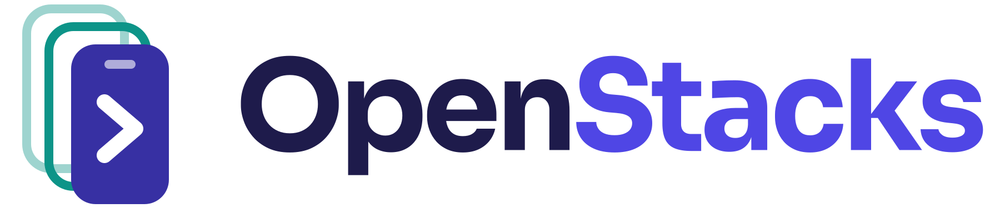
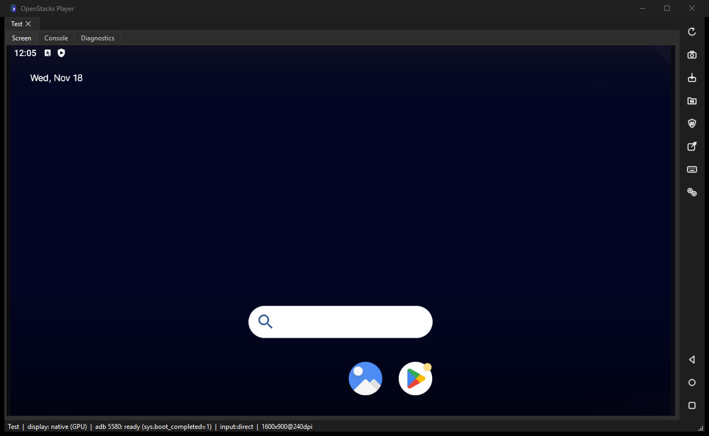
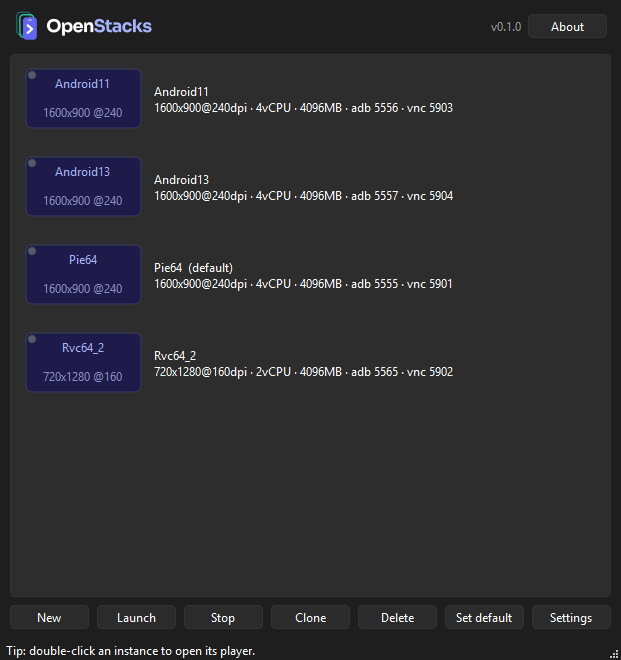
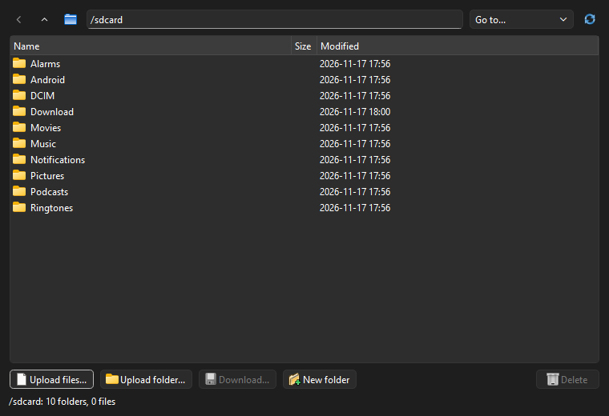

  <picture>
    <source media="(prefers-color-scheme: dark)" srcset="brand/svg/openstacks-logo-on-dark.svg">
    
  </picture>

  Run BlueStacks 5 Android images on QEMU, without the BlueStacks bloat.

  
  
  
  

  

---

OpenStacks is an Android emulator for Windows and Linux built from open parts. It runs on QEMU,
BlueStacks' paravirtual devices are reimplemented as QEMU devices, graphics go through Google's
[gfxstream](https://github.com/google/gfxstream), and a custom front-end works similarly to the
BlueStacks software. The Android images come straight from BlueStacks' download servers and are
debloated on your machine. BlueStacks itself doesn't need to be installed.

> OpenStacks is not affiliated with or endorsed by BlueStacks or now.gg.

### AI Usage Disclosure

As is made clear by the commit history, this project was built entirely by AI, just with minor human guidance. It was initially built using GLM-5.3-Flash, DeepSeek V4.1 Flash, and MiMo-V2.6-Flash before being transitioned to Claude Opus 5.5 and Sonnet 5.5.

## Features

- Android 7, 9, 11 and 13, downloaded when you create an instance
- No BlueStacks launcher, store, rewards or ads; [Lawnchair](https://github.com/LawnchairLauncher/lawnchair) as the home screen
- GPU acceleration (open renderer, or BlueStacks' own per instance); ARM apps and 3D games run
- Multiple instances with their own resolution, CPU and RAM
- File transfer, APK install and drag & drop
- One-click root with Magisk
- Full ADB access

  
  &nbsp;
  

## Requirements

Windows:

- Windows 10 or 11 (64-bit), with virtualization enabled
- **Windows Hypervisor Platform**: *Turn Windows features on or off*, tick it, reboot
- A GPU with up-to-date drivers (desktop OpenGL)
- Optional: **BlueStacks 5** installed, only for instances set to the BlueStacks renderer

Linux (x86-64):

- **KVM**: virtualization enabled, `/dev/kvm` usable by your user (usually the `kvm` group:
  `sudo usermod -aG kvm $USER`, then log in again)
- An X11 session, or Wayland with XWayland (GNOME, KDE and most others have it); the screen
  is an X11 window embedded in the player
- OpenGL with GLX (Mesa or the GPU vendor's driver)
- PulseAudio or PipeWire (`pipewire-pulse`) for sound
- glibc 2.35 or newer (Ubuntu 22.04, Debian 12, Fedora 36 and later)

OpenStacks checks these on first start and tells you what's missing.

## Getting started

Windows:

1. Download the latest `OpenStacks-<version>-win64.zip` from Releases and extract it anywhere.
2. Run `OpenStacks.exe`.

Linux:

1. Download the latest `OpenStacks-<version>-x86_64.AppImage` from Releases.
2. `chmod +x OpenStacks-*.AppImage` and run it.

The AppImage carries update information, so AppImage managers (AppManager, Gear Lever,
AppImageUpdate) can update it from the latest release, downloading only what changed.

Then:

3. Click **New**, name the instance and pick an Android version.
4. Double-click the instance to start it.

Everything OpenStacks stores goes in the `data` folder next to `OpenStacks.exe` (Windows) or
in `~/.local/share/OpenStacks` (Linux; `$OPENSTACKS_HOME` overrides both).

### The sidebar

| Button | Shortcut | |
|---|---|---|
| Rotate | Ctrl+Shift+R | Portrait / landscape |
| Screenshot | Ctrl+S | Saved to `screenshots` in the data folder |
| Install APK | Ctrl+I | Pick several files for split APKs |
| Files | Ctrl+Shift+F | Move files in and out |
| Root | | Install or remove Magisk |
| Pop out | Ctrl+Shift+P | Screen in its own window |

You can also drop files on the window: APKs get installed, anything else goes to the
instance's Download folder.

### ADB

Each instance's port is shown in the manager:

    adb connect 127.0.0.1:5555

## Building from source

Windows: you need [MSYS2](https://www.msys2.org) and Python 3.10+:

    pacman -S diffutils mingw-w64-ucrt-x86_64-{gcc,ninja,meson,pkgconf,python,glib2,pixman,libslirp,dtc}
    pip install -r frontend\requirements.txt

    qemu\build.cmd                  build QEMU with the OpenStacks devices
    renderer\build_gfxstream.cmd    build the open GPU renderer (VS 2022 with ClangCL)
    python frontend\run_player.py   run the app

Linux (Ubuntu 22.04 package names):

    sudo apt install build-essential ninja-build pkg-config python3-venv python3-tomli \
        libglib2.0-dev libpixman-1-dev libslirp-dev libfdt-dev zlib1g-dev libpulse-dev \
        clang cmake git libx11-dev libgl1-mesa-dev libegl1-mesa-dev libdrm-dev p7zip-full
    pip install -r frontend/requirements.txt

    qemu/build.sh                   build QEMU with the OpenStacks devices (build-linux/)
    renderer/build_gfxstream.sh     build the open GPU renderer (clang)
    python3 frontend/run_player.py  run the app

    packaging/build_linux.sh        all of the above + the AppImage (needs patchelf, curl)

The [build workflow](.github/workflows/build.yml) builds both platforms in parallel and
packages the release ZIP and AppImage; `packaging/` has the same steps for running locally.

For how it works and what's planned, see [NOTES.md](NOTES.md) (engineering log),
[docs/re](docs/re) (protocol specs) and [BACKLOG.md](BACKLOG.md).

## License

[GPL-2.0-or-later](LICENSE). Bundled and downloaded third-party software is listed in
[THIRD-PARTY.md](THIRD-PARTY.md).
